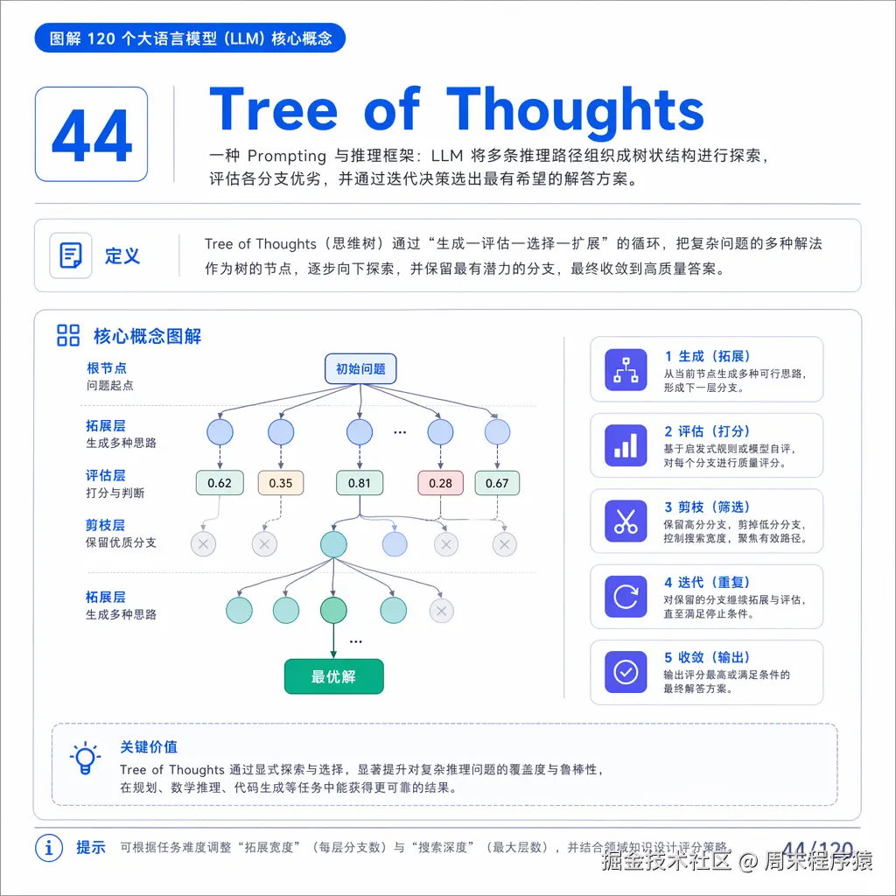

# 圖解 120 個 LLM 核心概念（31-60）— 圖片補充

> 補充說明：原剪藏檔（同名無 `-images` 後綴）只抓到頁面外殼，文章主體的 30 張概念圖被 Web Clipper 的內容擷取演算法略過。本檔於 2026-07-14 由 AI 從原網頁補抓。26 張為 imgur 穩定連結；llm44/49/50/55 四張原始來源為掘金 CDN 簽名網址（x-expires 約 2026-07-17 失效且有防盜連），已截圖存為本地檔（見下方標注）。

